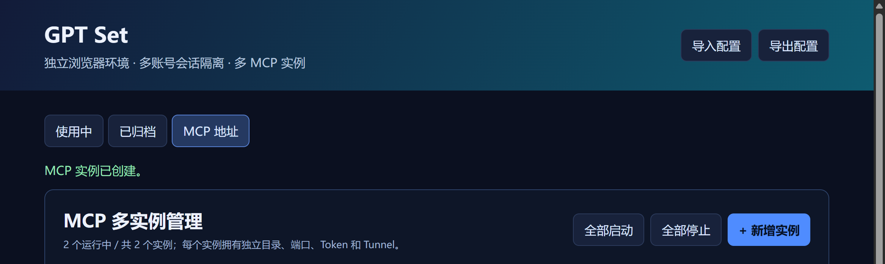

<div align="center">

# GPT Set

### Windows 多账号 ChatGPT 客户端与本地 MCP 工作台

为不同账号创建彼此隔离的 Chromium 浏览器环境，并为每个环境绑定本地文件 MCP 实例和图片桥接扩展。

[](https://github.com/xieguu/gpt-set/releases)
[](https://github.com/xieguu/gpt-set/releases)
[](https://nodejs.org/)
[](LICENSE)

[下载发布版](https://github.com/xieguu/gpt-set/releases) · [问题反馈](https://github.com/xieguu/gpt-set/issues) · [架构设计](设计说明.md)

</div>

## 功能

- **独立浏览器环境**：分别保存 Cookie、LocalStorage、IndexedDB、缓存和 Service Worker 数据。
- **环境配置管理**：设置启动网址、代理和窗口尺寸；复制配置时会创建新的登录分区。
- **登录态迁移**：导入或导出 Cookie。登录态文件包含账号凭据，需妥善保管。
- **本地 MCP 多实例**：为每个实例配置独立工作目录、端口和 Token，并管理服务进程及 Cloudflare Quick Tunnel。
- **工作区文件工具**：在指定目录内列出、读取、写入、移动和删除文件；路径越界和符号链接会被拒绝。
- **图片桥接**：捕获 ChatGPT 助手消息中生成的图片，并保存到对应 MCP 工作区。
- **Windows 便携版**：发布为无需单独安装 Node.js 的 x64 EXE。



## 快速开始

### 使用便携版

从 [Releases](https://github.com/xieguu/gpt-set/releases) 下载 `GPT-Set-*-portable.exe`，放到希望长期保留的目录后运行。升级前先完全退出 GPT Set，再替换 EXE。

程序无需安装，但配置和登录会话会保存在 `%APPDATA%\gpt-set-client`。备份或迁移时，请在程序退出后复制该目录。

### 从源码运行

需要 Windows 10/11、Node.js 20 或更高版本及 npm：

```powershell
git clone https://github.com/xieguu/gpt-set.git
cd gpt-set
npm ci --prefix local-mcp-server
cd client
npm ci
npm start
```

源码版使用独立的 `%APPDATA%\gpt-set-client-dev` 数据目录，不与便携版共享登录会话或单实例锁。首次启动后，在主界面创建浏览器环境并登录。

## 连接本地 MCP

1. 在主界面打开 **MCP 地址**，创建实例并选择允许访问的工作目录。
2. 设置 `1024–65535` 范围内的端口，或选择自动分配，然后启动实例。
3. 需要让 ChatGPT 网页端访问本机服务时，启动 Tunnel，并在连接器中填写生成的 HTTPS MCP 地址。
4. 创建或编辑浏览器环境时绑定 MCP 实例。GPT Set 会为该环境配置图片桥接扩展。

默认服务只监听本机地址。多个实例可并行运行，例如：

```text
http://127.0.0.1:8787/mcp
http://127.0.0.1:8788/mcp
```

Quick Tunnel 地址会在进程重启后变化。需要固定域名时，使用 Cloudflare Named Tunnel。更多配置见 [`local-mcp-server/README.md`](local-mcp-server/README.md)。

### MCP 工具

| 工具 | 用途 |
| --- | --- |
| `list_directory`、`get_file_info` | 查看目录和文件元数据 |
| `read_file`、`write_text` | 读取或写入 UTF-8 文本 |
| `write_image`、`save_image_from_url` | 保存图片数据或公开 HTTPS 图片 |
| `create_directory`、`move_path`、`delete_path` | 创建、移动或确认删除路径 |
| `list_captured_images`、`save_captured_image` | 查看并保存图片桥接扩展捕获的图片 |

图片支持 PNG、JPEG、WebP 和 GIF，单张上限为 10 MiB。扩展最多并发上传 2 张图片，并对可重试的网络错误进行有限次数重试。使用说明见 [`chatgpt-image-bridge-extension/README.md`](chatgpt-image-bridge-extension/README.md)。

## 数据与安全

| 数据 | 位置 |
| --- | --- |
| 便携版环境配置和 MCP 实例配置 | `%APPDATA%\gpt-set-client` |
| 便携版浏览器登录分区 | `%APPDATA%\gpt-set-client\Partitions` |
| 源码版全部用户数据 | `%APPDATA%\gpt-set-client-dev` |
| MCP 图片收件箱 | 对应实例工作目录下的 `.chatgpt-image-inbox/` |

- 配置导入/导出不包含浏览器登录会话；登录态导入/导出会迁移 Cookie，并创建独立分区。
- 每个 MCP 实例默认使用 Bearer Token。不要提交 `.env`、`mcp-instances.json`、登录态文件或用户数据目录。
- MCP 默认仅监听 `127.0.0.1`。启用 Tunnel 会使服务可从外部访问；请保留鉴权，不要公开无认证的写入服务。
- 删除工具要求显式确认。发现 Token 泄露时，应立即轮换。

## 开发与构建

在仓库根目录运行：

```powershell
npm ci --prefix local-mcp-server
npm run check --prefix client
npm test --prefix client
npm test --prefix local-mcp-server
npm run test:integration --prefix client
```

构建 Windows x64 便携版：

```powershell
cd client
npm ci
npm run dist:win
```

产物位于 `client\dist\GPT-Set-0.1.0-portable.exe`。发布前可计算 SHA-256：

```powershell
Get-FileHash .\client\dist\GPT-Set-0.1.0-portable.exe -Algorithm SHA256
```

## 项目结构

```text
client/                          Electron 客户端、环境管理和 MCP 进程管理
local-mcp-server/                本地文件 MCP 服务
chatgpt-image-bridge-extension/  ChatGPT 图片桥接扩展
docs/images/                     文档截图
设计说明.md                       架构设计文档
```

## License

[MIT](LICENSE)
